# Symmetry

One thumb, either hand, every control mirrored: controller skins for Delta on iPhone.

Symmetry gives every Console two Layouts. **One** is portrait, for a single thumb on either hand:
every control the game needs is mirrored to both sides, so whichever hand holds the phone has all
of them. **Full** is landscape, for two hands: the game as large as the width allows, the controls
on the rails beside it.

## Consoles

### Advance

Game Boy Advance. In portrait the whole game sits on top and the deck below mirrors everything:
an A/B pair either side of the D-pad, both shoulders in each bottom corner, START and SELECT in
each top corner, SAVE and fast-forward under the screen. In landscape the game takes the phone's
full height, with outline controls floating over it.

  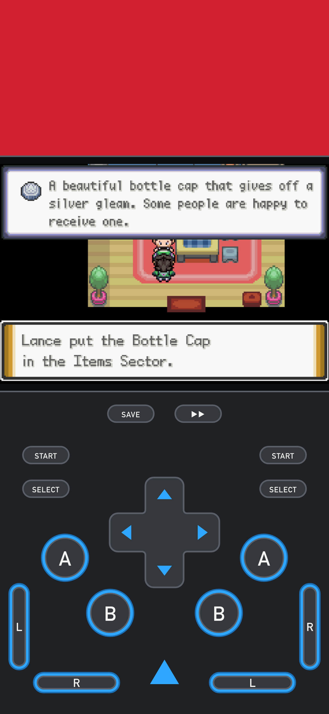
  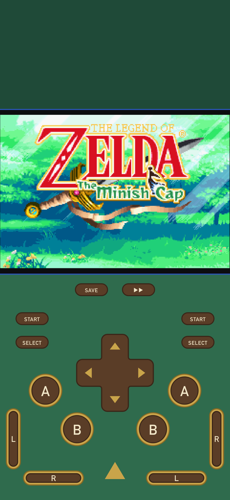

  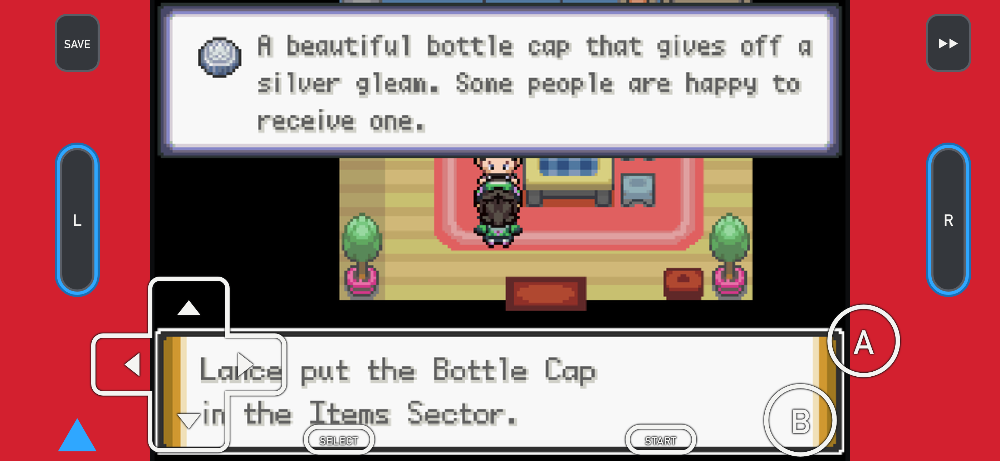
  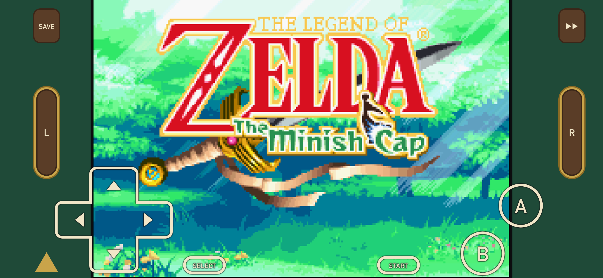

### DS

Nintendo DS, in two variants: plain, and **Reverse**, where the touch screen takes the large
frame. In portrait a large screen sits over a smaller one, above a mirrored deck: A/B pairs with X/Y above them around a
centred D-pad, both shoulders and a quick action on each rail beside the touch screen, START and
SELECT in both bottom corners. In landscape the large and small screens sit side by side along the
top with the controls below and on the rails, so nothing ever covers the touch screen.

  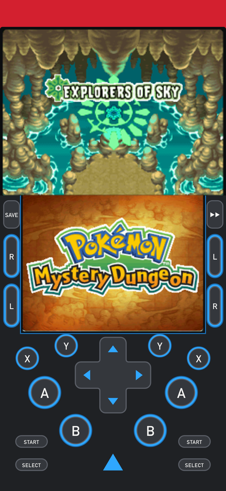
  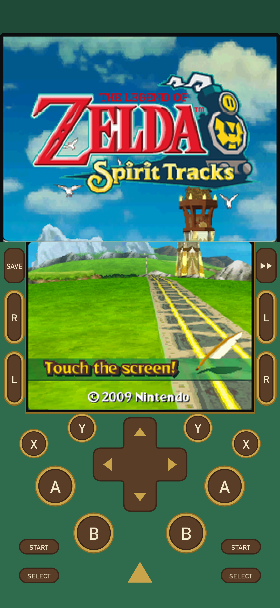

  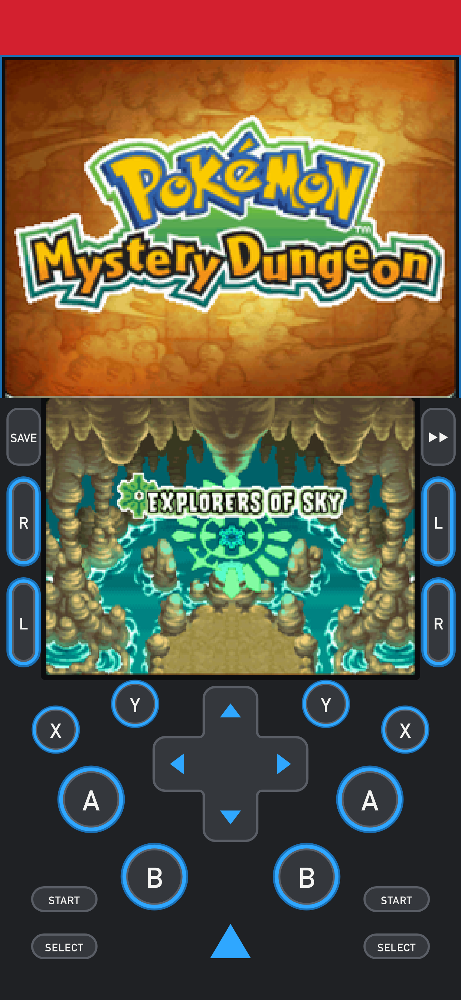
  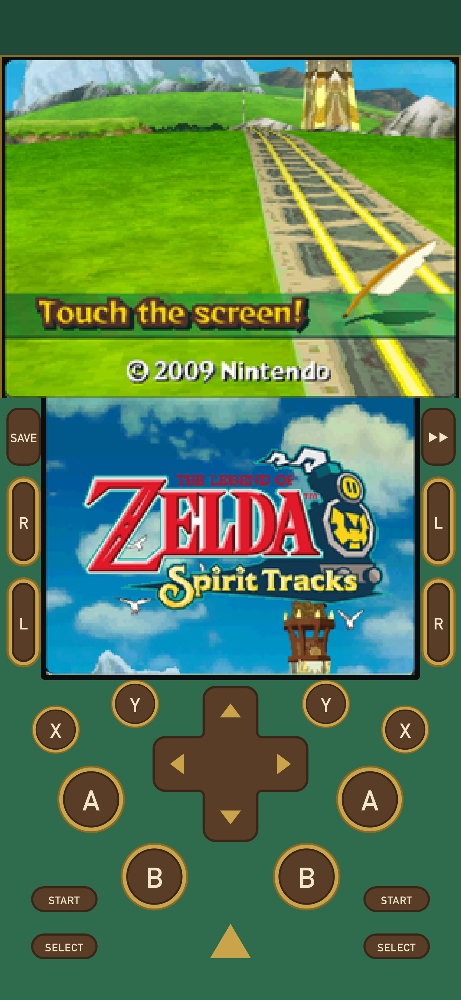

  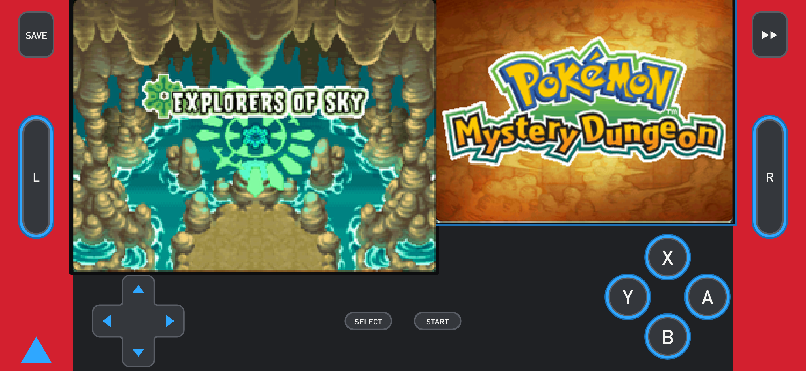
  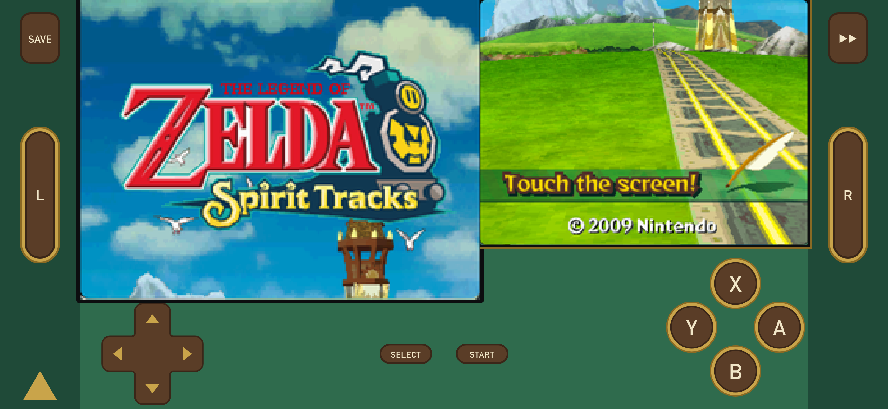

  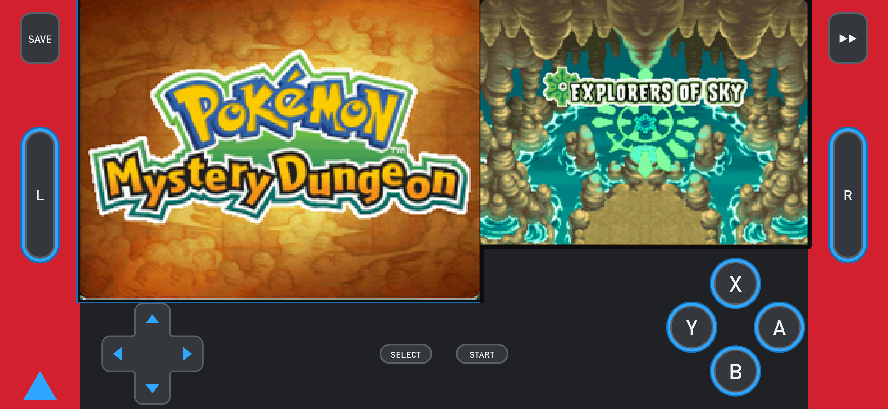
  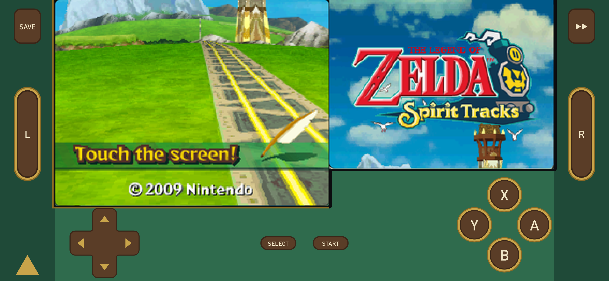

### Color

Game Boy and Game Boy Color. In portrait the game runs full width at the Game Boy's own 10:9 over
the Advance deck without its shoulders: A/B pairs on both sides, START and SELECT in each top
corner, SAVE and fast-forward under the screen. In landscape the game takes the phone's full
height, with solid controls on the rails either side and nothing over the picture.

  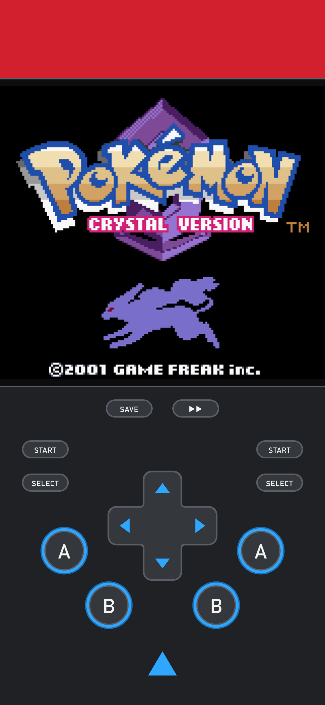
  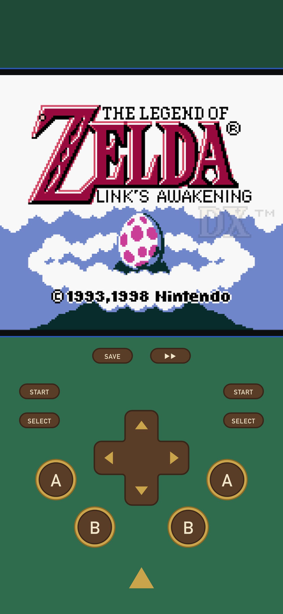

  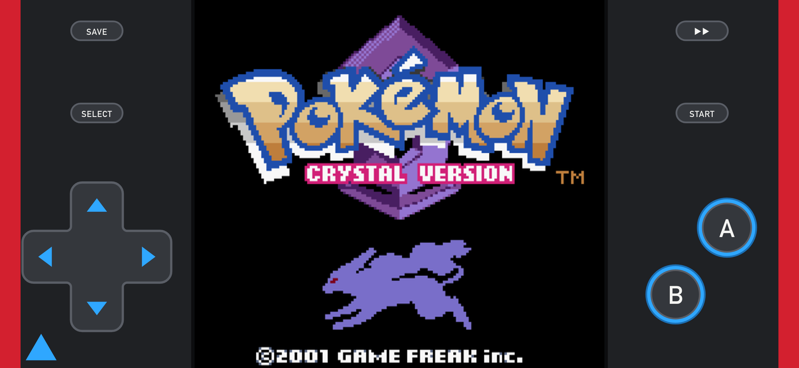
  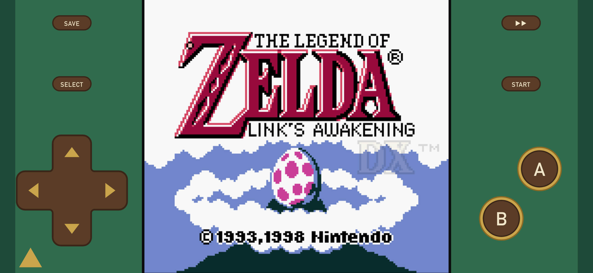

## Themes

- **Dex**: red body, dark grey deck, blue rings, white labels.
- **Hero**: two forest greens, wood controls with gold rings, a Hylian blue hairline around the
  screen.

## Download

Get the latest Release from the
[Releases page](https://github.com/skramstudios/skram-emulator/releases/latest). Each Release
carries every Skin: one `.deltaskin` per Console and Theme, named
`Symmetry-One-<Console>-<Theme>[-Reverse]-<version>.deltaskin`, plus
`Symmetry-One-<version>.zip` with all of them.

## Install

1. Download the `.deltaskin` on your iPhone and tap it, then Share → Delta.
2. In Delta, long-press the game → Change Controller Skin, and set the Skin for both Portrait and
   Landscape.

To update a Skin, delete the old one from Delta first, then import the new file.

Symmetry is made on an iPhone 13 Pro Max (notch) for edge-to-edge iPhones.

## Changelog

What changed in each Release: [CHANGELOG.md](CHANGELOG.md).

## License

Symmetry by LancelotLac is licensed under [CC BY 4.0](LICENSE): share and adapt it, with credit.

Symmetry is not affiliated with or endorsed by Nintendo or by Delta's author. Game Boy, Game Boy
Advance and Nintendo DS are trademarks of Nintendo.
